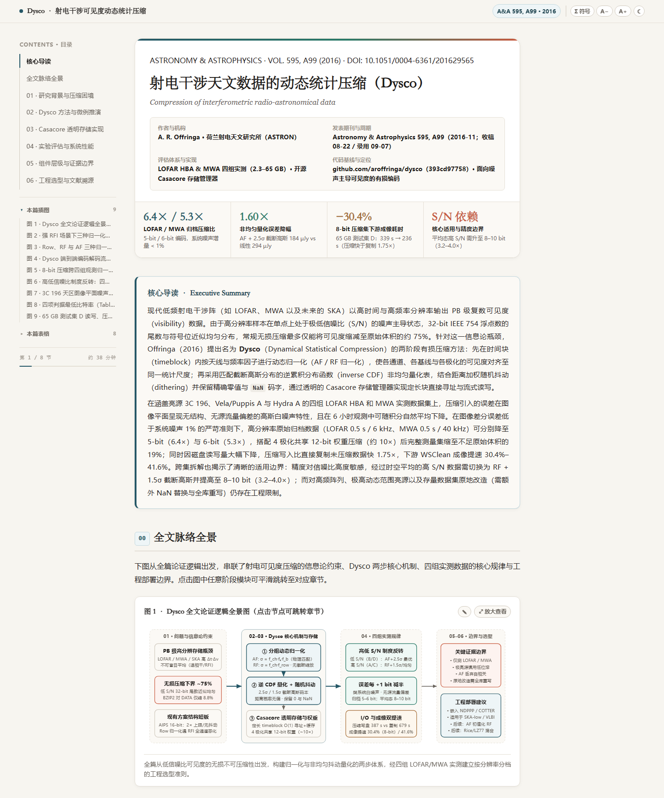
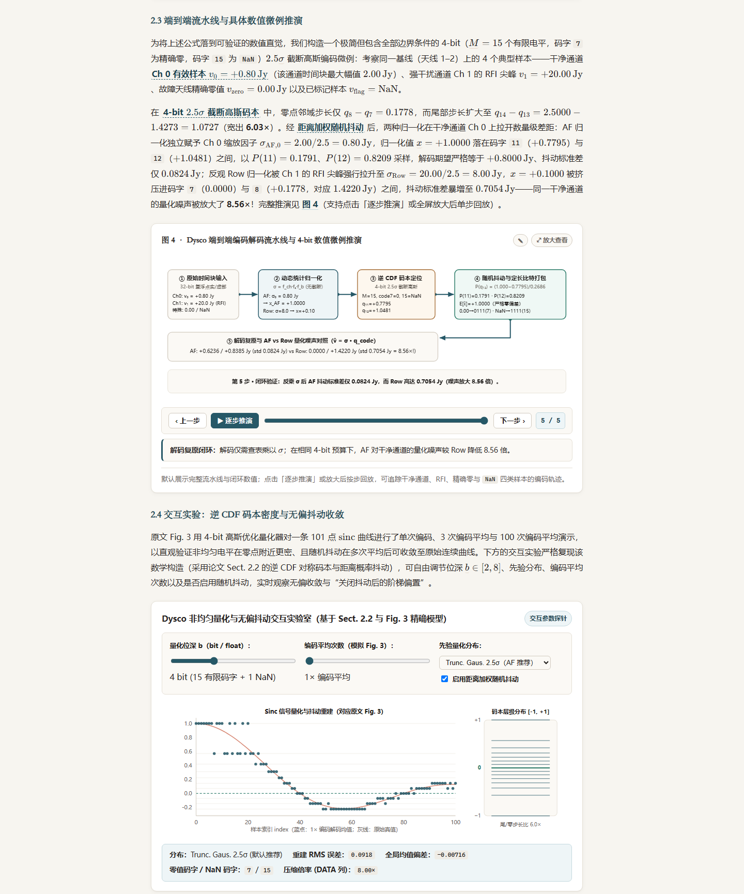
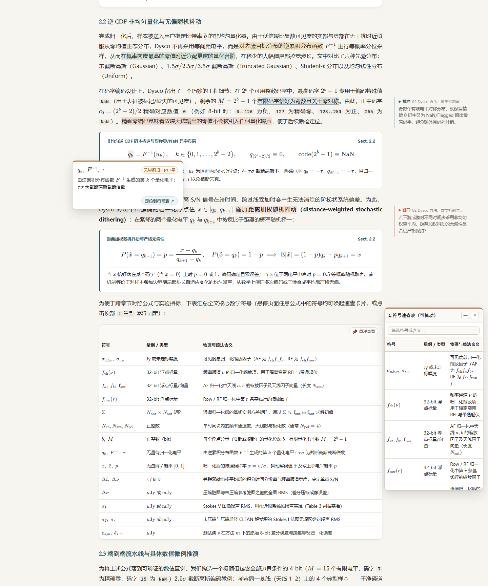
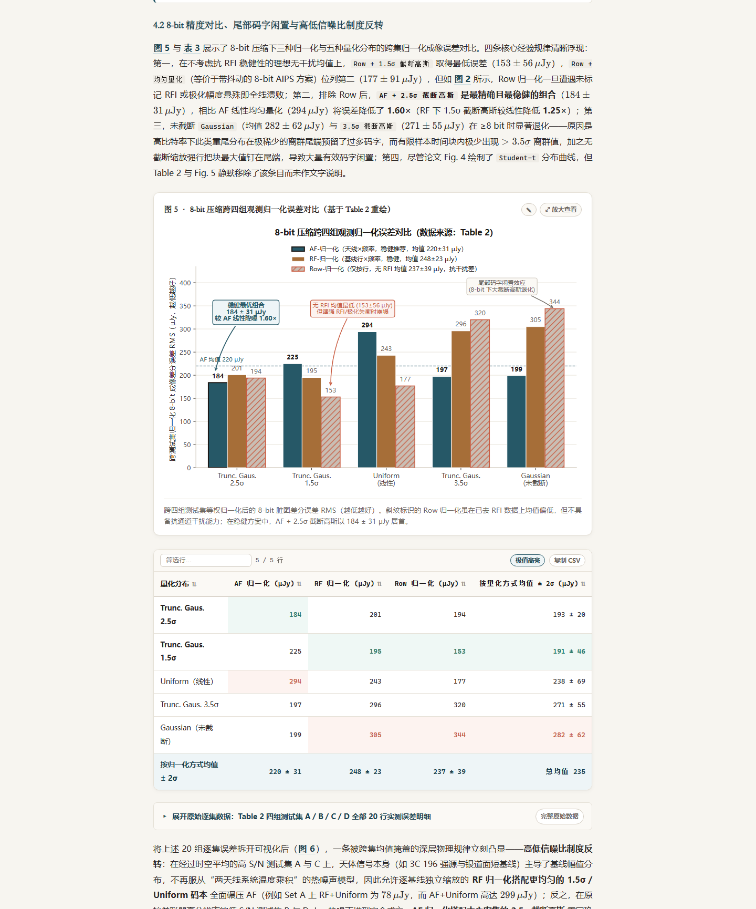

# paper-deep-reader

[简体中文](README.md) | **English**

[](LICENSE)
[](#quick-start)
[](#live-preview)

An Agent Skill that turns a research paper PDF (local file, arXiv, Open-Access DOI, or Zotero item) into a **single-file interactive HTML deep-reading monograph**—with hoverable equation symbols, step-through mechanism diagrams, zoomable vector charts, and highlight-and-annotate reading tools.

---

## Live Preview

- **Online Interactive Demo (GitHub Pages)**: [Offringa (2016) Dysco Deep-Reading Monograph](https://yangyannick.github.io/paper-deep-reader/examples/offringa-2016-dysco-demo.html)
- **Original Paper (Open Access)**: [Offringa (2016), *Astronomy & Astrophysics* 595, A99 (DOI: `10.1051/0004-6361/201629565`)](https://doi.org/10.1051/0004-6361/201629565)

Generated in a single unedited run from the 13-page Offringa (2016) radio-interferometric compression paper (~1.5 MB single file, no server or build step required); pass the DOI above to `$paper-deep-reader` to reproduce.

| Editorial Layout, Outline Drawers & Paper Panorama | Interactive Worked-Example Stepper & Parameter Lab |
| :---: | :---: |
|  |  |
| **Equation Symbol Hover, Floating Sheet & 3-Color Highlights** | **Morandi Vector Charts & Inline Interactive Tables** |
|  |  |

---

## Core Features

- **Page-by-page visual grounding**: Renders every PDF page to PNG to verify equations, tables, and footnotes visually before writing—eliminating text-extraction errors and fabricated numbers.
- **Interactive diagrams & parameter labs**: Builds clickable paper panoramas, worked-example step-through pipelines, multi-view comparisons, and equation-grounded interactive parameter labs.
- **Equation symbol lookup & 3-color annotations**: Hover directly over rendered math for instant symbol definitions, pin and drag a searchable floating symbol sheet, highlight passages in 3 colors, take wide-screen margin notes, and export cleanly to Markdown.
- **Editorial reading workbench**: Warm Paper Light / Midnight Slate Dark themes, outline rail with collapsible figure & table indexes, inline sortable/filterable tables, vector pan/zoom lightbox, and clean print styling.
- **Multi-source input & single-file delivery**: Supports local PDFs, arXiv, Open-Access DOIs, and Zotero 7+, bundling everything into one self-contained `.html` file (with optional `--offline-katex` for 100% air-gapped math).

---

## Quick Start

### 1. Install the Skill

Works with **Claude Code**, **Codex**, **Cursor**, **Antigravity**, and any Agent Skills–compatible assistant:

```bash
# Option A: Install via skills CLI
npx skills add yangyannick/paper-deep-reader

# Option B: Clone directly into your local skills directory
git clone https://github.com/yangyannick/paper-deep-reader.git ~/.agents/skills/paper-deep-reader
```

> Configured for explicit invocation so it never hijacks casual paper questions. Trigger it by naming `paper-deep-reader` / `$paper-deep-reader` or requesting an interactive HTML deep-reading page.

### 2. Install Python Dependencies

```bash
pip install -r requirements.txt
```

- **Core**: `pymupdf`, `matplotlib`, `numpy`, `pillow` (used for PDF rendering, image optimization, and quantitative vector plots). `scripts/fetch_paper.py` uses Python's standard library only.
- **Optional QA tools**: Node.js (`node --check` for inline JS syntax verification) and Chrome / Chromium / Edge (auto-detected for 1440px headless visual QA and DOM geometric audit).

---

## Supported Inputs

| Input Source | Extra Plugin | How It Works |
| :--- | :---: | :--- |
| **Local PDF** (`path/to/paper.pdf`) | None | Default offline entry; extracts text and renders all pages for visual verification. |
| **arXiv ID / URL** (`1706.03762`, etc.) | None | Built-in `scripts/fetch_paper.py` fetches Atom metadata and downloads the PDF. |
| **Open-Access DOI** (`10.1051/...`) | None | Fetches Crossref metadata and checks OpenAlex, Europe PMC, Semantic Scholar, and optional Unpaywall for legal OA PDFs. |
| **Paywalled DOI** (`10.1109/...`) | None | Saves bibliographic metadata and stops (`exit 2`) asking for a local PDF or Zotero entry—never fabricates content or uses unauthorized sources. |
| **Zotero 7+ Local Library** | None | Compatible with Zotero 7 / 8 / 9 / 10 via the local API (`127.0.0.1:23119`); reads metadata/notes and auto-resolves local PDFs (including custom data directories). Also seamlessly uses `zotero-cli` / `zotero-mcp` if installed. |

---

## Usage Examples

### In an Agent Session

**1. Open-Access DOI (Signal Processing / Scientific Computing / Compression Paper)**
```text
Use $paper-deep-reader on DOI 10.1051/0004-6361/201629565 (Dysco). Include a clickable paper panorama, a worked-example step-through pipeline, an interactive quantization/dithering lab, and inline sortable data tables.
```

**2. arXiv Paper (Deep Learning / Architecture Paper)**
```text
Use $paper-deep-reader on arXiv:2312.00752 (Mamba). Focus on a linked-highlight data-flow diagram, tensor-shape stepping, ablation small multiples, and sequence-length scaling charts.
```

**3. Zotero Local Library (With Existing Notes)**
```text
Use $paper-deep-reader to read "Compression of interferometric radio-astronomical data" from my Zotero library, and incorporate my Zotero notes into the final engineering insights section.
```

**4. Local PDF & Domain-Transfer Engineering Audit**
```text
Use $paper-deep-reader on ./papers/bitshuffle-2015.pdf. In the final section, evaluate how it transfers to 16-bit high-rate scientific DAQ streams, including memory overhead and failure boundaries.
```

**5. Full English or Air-Gapped Offline Archive**
```text
Use $paper-deep-reader on arXiv:1706.03762 and write the entire standalone interactive HTML monograph in English with --offline-katex enabled.
```

### Standalone CLI Utilities

```bash
# 1. Fetch metadata & PDF (arXiv / OA DOI / Zotero 7+)
python scripts/fetch_paper.py --source 1706.03762 --out ./temp/demo
python scripts/fetch_paper.py --source 10.1051/0004-6361/201629565 --out ./temp/demo
python scripts/fetch_paper.py --zotero-query "Dysco" --out ./temp/demo

# 2. Extract full text, page index & all-page 150 DPI verification PNGs
python scripts/extract_pdf.py --pdf ./temp/demo/paper.pdf --out ./temp/demo

# 3. Assemble standalone HTML (inline vector SVGs, auto-optimized images & optional --offline-katex)
python scripts/assemble_html.py --title "Demo" --body ./temp/demo/body.html --out ./temp/demo/out.html \
  --svg SVG_PLOT1=./temp/demo/plot1.svg --img IMG_FIG1=./temp/demo/crops/fig1.png --offline-katex

# 4. Run static QA on a generated HTML file (KaTeX, duplicate IDs, stepper/view bindings, JS syntax, clichés)
python scripts/qa_static.py examples/offringa-2016-dysco-demo.html --strict-cliches

# 5. Capture 1440px full-page headless browser slices & run DOM geometric/runtime audit
python scripts/qa_browser_shots.py --html examples/offringa-2016-dysco-demo.html --out ./temp/demo/qa_shots
```

---

## Workflow & Repository Layout

The skill runs in four stages: **1. Source grounding & all-page visual verification** → **2. Monograph synthesis with worked examples & scope audit** → **3. Structured interactive diagrams, inspected Matplotlib plots & single-file assembly** → **4. Static + 1440px browser visual QA**.

```text
paper-deep-reader/
├── SKILL.md                           # 4-stage workflow, input adapters & declarative visual stack
├── agents/
│   └── openai.yaml                    # Explicit-invocation policy for Codex
├── assets/
│   ├── theme-morandi.css              # Warm Paper Light / Midnight Slate Dark themes, widgets & print CSS
│   ├── widgets.js                     # Declarative stepper, equation symbol hover, floating sheet, 3-color highlights, notes & lightbox
│   └── morandi-academic.mplstyle      # Harmonized Matplotlib academic style
├── references/
│   ├── academic-writing-guide.md      # Narrative order, worked examples, figure pacing & scope audit
│   ├── diagram-and-layout-guide.md    # Structured diagrams, Morandi layout quick-reference & declarative recipes
│   └── plotting-guide.md              # Visual-argument plotting, redraw vs crop rules & QA checklist
├── scripts/
│   ├── fetch_paper.py                 # Stdlib-only fetcher (arXiv / OA DOI / PDF URL / Zotero 7+)
│   ├── extract_pdf.py                 # PyMuPDF text extraction & all-page 150 DPI page renderer
│   ├── assemble_html.py               # Single-file HTML bundler (SVG/image inline optimizer, ID prefixer, --offline-katex)
│   ├── qa_static.py                   # Static QA (KaTeX, IDs, interactive bindings, clichés, node --check)
│   └── qa_browser_shots.py            # Cross-platform 1440px visual QA slicer & DOM geometric/runtime auditor
├── docs/images/                       # README showcase screenshots
├── examples/
│   └── offringa-2016-dysco-demo.html  # Complete standalone HTML demo (Offringa 2016, A&A)
├── requirements.txt
├── README.md                          # Simplified Chinese documentation (default)
├── README.en.md                       # English documentation
└── LICENSE                            # MIT
```

---

## FAQ

- **Why did a DOI return `PAYWALL_OR_NO_OA_PDF`?**  
  Subscription publishers (e.g., IEEE, Elsevier, Springer non-OA papers) do not expose full-text PDFs through public APIs. `fetch_paper.py` queries legal open-access sources only and stops rather than letting the model hallucinate equations or tables from an abstract. Supply a local PDF or read via Zotero. Setting `UNPAYWALL_EMAIL=you@example.com` also enables Unpaywall lookups for repository/author-accepted versions.
- **How do I enable Zotero 7+ Local API?**  
  Open Zotero (7 / 8 / 9 / 10) → **Settings → Advanced → General** → enable *"Allow other applications on this computer to communicate with Zotero"*. The script resolves the actual disk path automatically via the `/file` endpoint, even when your Zotero data folder is stored in a custom location.
- **Does the generated HTML work offline?**  
  By default all CSS, JS, tables, vector SVG figures, and cropped images are embedded in one `.html` file (typically ~250–500 KB for vector-only papers, or ~1–2 MB for long papers with high-DPI cropped original figures; only KaTeX fonts load from CDN). Pass `--offline-katex` to `scripts/assemble_html.py` to inline compact WOFF2-only KaTeX for 100% air-gapped math rendering.

---

## Credits & License

All templates, stylesheets, scripts, and guides in this repository are written from scratch under the [MIT License](LICENSE). The workflow draws inspiration from several open-source ideas:
- Vector mechanism diagrams, linked highlighting, steppers, Before/After diffs, and selection-note workflows inspired by [`visual-explainer`](https://github.com/nicobailon/visual-explainer) (MIT).
- Worked micro-examples, component role analysis, and evidence-boundary checks inspired by academic paper X-ray workflows.
- Visual-argument-first render–inspect–revise Matplotlib loops inspired by academic plotting workflows.
- Local library integration compatible with Zotero 7+ Local API and [`zotero-mcp`](https://github.com/54yyyu/zotero-mcp) (MIT).
