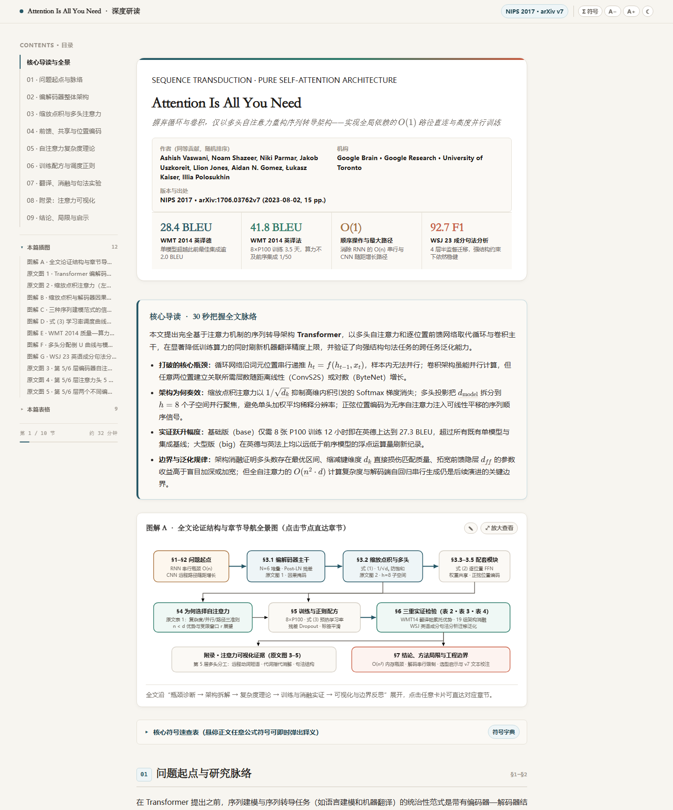
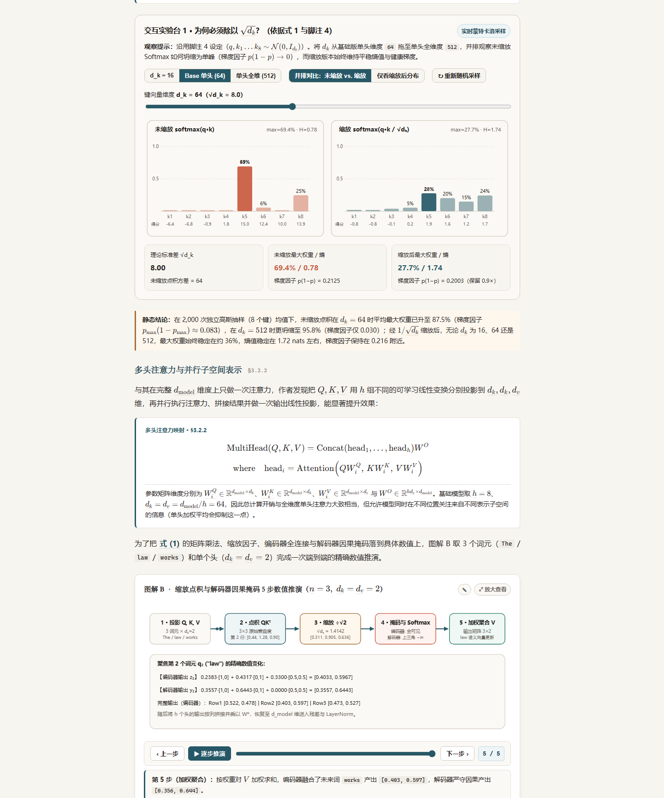
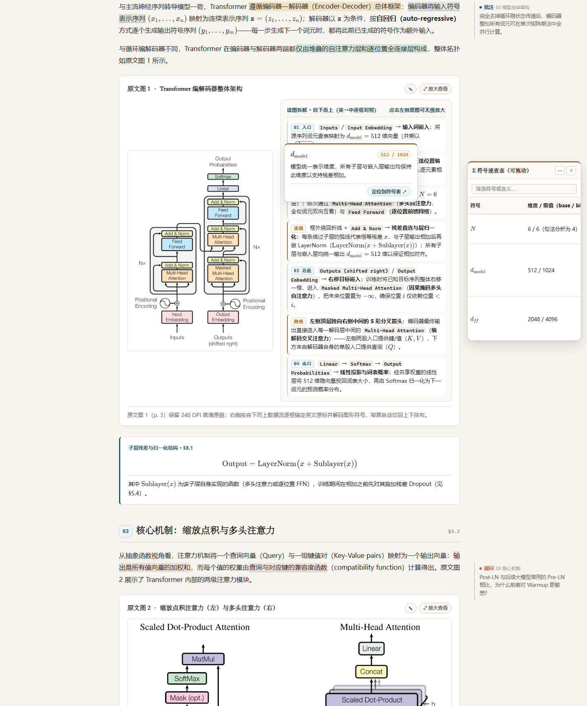
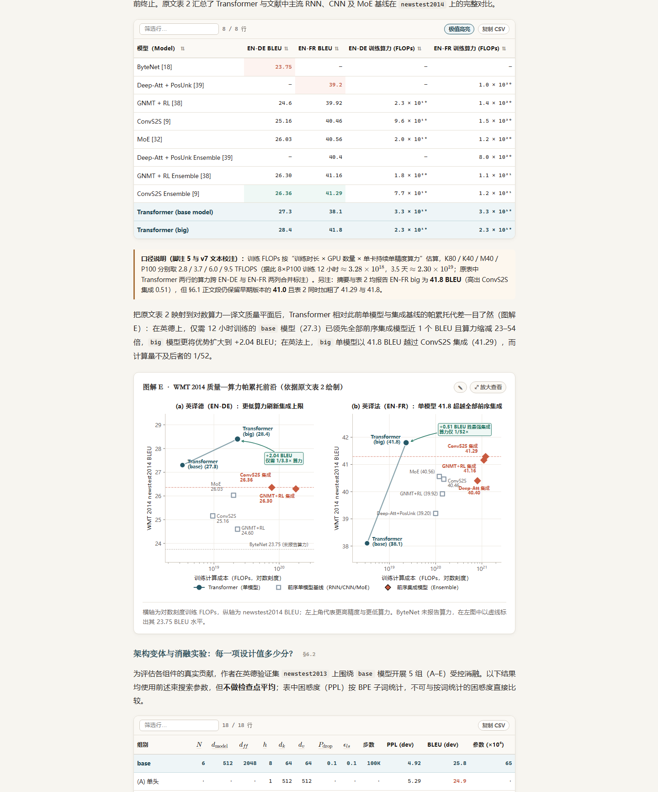

# paper-deep-reader

**简体中文** | [English](README.en.md)

[](LICENSE)
[](#快速开始)
[](#效果预览)

一个面向科研论文深度精读的 Agent Skill。输入本地 PDF、arXiv、开放获取 DOI 或 Zotero 文献，将其转化为**可完全替代原文、又更易于读懂的单文件交互式 HTML 精读长文**——完整保留原文论证、公式、图表与附录，并按实际阅读障碍按需配备逐框读图指南、可悬停查符号的公式、步进推演流程图、定制交互实验与高亮批注工作台。

---

## 效果预览

- **在线交互预览（GitHub Pages）**：[Vaswani et al. (2017) *Attention Is All You Need* 中文完整精读](https://yangyannick.github.io/paper-deep-reader/examples/vaswani-2017-attention-zh.html) · [English Version](https://yangyannick.github.io/paper-deep-reader/examples/vaswani-2017-attention-en.html)
- **原论文对照（开放获取）**：[Vaswani et al. (2017), *Attention Is All You Need*（NeurIPS 2017 / `arXiv:1706.03762v7`，15 页完整版含注意力可视化附录）](https://arxiv.org/abs/1706.03762)

示例基于 15 页完整版 `arXiv:1706.03762v7` 原生生成（含全部 5 幅原文图、4 张原文表与附录），中文单文件约 1.15 MB、英文单文件约 1.27 MB，双击即可在浏览器中打开；也可直接将 `arXiv:1706.03762` 交给 `$paper-deep-reader` 复现。

| 刊物排版、核心速览与可点击全文全景图 | 公式驱动交互实验台与 5 步数值微例推演 |
| :---: | :---: |
|  |  |
| **竖图左图右解、公式符号速查与三色划词批注** | **行内交互数据表（极值高亮）与 Morandi 矢量统计图** |
|  |  |

---

## 核心特性

- **原文层完整覆盖与自动清点**：优先选用最全版本，全页转图逐页核对公式、表格与脚注；`extract_pdf.py` 自动输出原文图表清单，`qa_static.py --inventory` 核查每张原图原表是否均有交代，绝不静默遗漏。
- **保真原图 + 路径锚定读图拆解**：数据统计图按 Morandi 风格重绘；复杂架构与机制原图以 240 DPI 高清保留，并按流向配「英文原标 → 中文译名 + 图形符号解码」读图指南（竖图自动左图右解，横图上图下解）。
- **交互式步进图解与问题驱动实验台**：支持全文全景点击跳转、阶段卡片悬停预览与点击跳步的 `.fig-steps` 推演图（含灯箱内同步操作），以及按论文显式公式定制的零死控件交互实验。
- **公式符号速查与三色高亮批注**：公式原位悬停即看符号释义，支持置顶拖动的悬浮符号表、三色划词高亮、宽屏页边旁注与 Markdown 一键导出。
- **多源输入与单文件交付**：原生支持本地 PDF、arXiv、开放获取 DOI 与 Zotero 7+，输出单个自包含 HTML（Warm Paper 浅色 / Midnight Slate 深色、纯净打印，附加 `--offline-katex` 可纯断网阅读）。

---

## 快速开始

### 1. 安装 Skill

兼容 **Claude Code**、**Codex**、**Cursor**、**Antigravity** 及支持 Agent Skills 规范的助手：

```bash
# 方式一：通过 skills CLI 安装
npx skills add yangyannick/paper-deep-reader

# 方式二：直接克隆到本地 skills 目录
git clone https://github.com/yangyannick/paper-deep-reader.git ~/.agents/skills/paper-deep-reader
```

> 本 Skill 默认配置为显式触发，不会在你随口询问论文问题时误启动。使用时在提示词中提及 `paper-deep-reader` / `$paper-deep-reader`，或明确要求生成交互式 HTML 精读页面即可。

### 2. 安装 Python 依赖

```bash
pip install -r requirements.txt
```

- **核心依赖**：`pymupdf`、`matplotlib`、`numpy`、`pillow`（用于 PDF 渲染、原图优化与矢量统计图）。论文拉取脚本 `scripts/fetch_paper.py` 仅使用 Python 标准库，无额外依赖。
- **可选质检环境**：Node.js（用于 `node --check` 校验内联 JS 语法）及本机 Chrome / Chromium / Edge（自动探测，用于 1440px 无头截图审查与 DOM 几何体检）。

---

## 支持的输入源

| 输入方式 | 额外插件 | 说明 |
| :--- | :---: | :--- |
| **本地 PDF**（`path/to/paper.pdf`） | 不需要 | 默认入口，离线可用，全页渲染并逐页视觉核验内容。 |
| **arXiv ID / 链接**（`1706.03762` 等） | 不需要 | 内置 `scripts/fetch_paper.py` 自动拉取元数据并下载完整版 PDF。 |
| **开放获取 DOI**（`10.1051/...`） | 不需要 | 查 Crossref 书目信息，并依次从 OpenAlex、Europe PMC、Semantic Scholar、可选 Unpaywall 获取合法 OA PDF。 |
| **付费墙 DOI**（`10.1109/...`） | 不需要 | 仅保存书目元数据并停下提示提供本地 PDF 或 Zotero 条目（退出码 `2`），不凭摘要硬编，也不调用灰色源。 |
| **Zotero 7+ 本地文献库** | 不需要 | 兼容 Zotero 7 / 8 / 9 / 10，直连本地 API（`127.0.0.1:23119`），自动读取元数据、笔记并定位本地 PDF（含自定义数据目录）。若已装 `zotero-cli` / `zotero-mcp` 也可直接复用。 |

---

## 使用示例

### 在对话中调用

**1. arXiv 论文（深度学习 / 架构类论文）**
```text
使用 $paper-deep-reader 深度精读 arXiv:1706.03762（Attention Is All You Need），完整覆盖全部 5 张原图（含附录可视化）与 4 张表，为架构原图配路径锚定读图拆解，并加入缩放点积交互实验台与 3 词元步进数值推演。
```

**2. 开放获取 DOI（信号处理 / 科学计算 / 编解码类论文）**
```text
使用 $paper-deep-reader 深度精读 DOI 10.1051/0004-6361/201629565（Dysco），包含全文脉络全景图、带数值微例的步进流程图、定制量化抖动参数实验室与行内可筛选排序数据表。
```

**3. 从 Zotero 读取文献并融合已有笔记**
```text
使用 $paper-deep-reader 读取我 Zotero 里的《Attention Is All You Need》，并把我已有的 Zotero 笔记结合进文末的局限与延伸启示部分。
```

**4. 本地 PDF 并分析领域迁移边界**
```text
使用 $paper-deep-reader 精读 ./papers/bitshuffle-2015.pdf，在文末结合我的研究方向（16-bit 高速科学采集数据流的实时无损压缩）分析可迁移点、内存开销与失效边界。
```

**5. 输出全英文或 100% 离线归档版**
```text
Use $paper-deep-reader on arXiv:1706.03762 and write the entire standalone interactive HTML monograph in English with --offline-katex enabled.
```

### 独立运行内置脚本（CLI）

```bash
# 1. 拉取论文元数据与 PDF（arXiv / OA DOI / Zotero 7+）
python scripts/fetch_paper.py --source 1706.03762 --out ./temp/demo
python scripts/fetch_paper.py --source 10.1051/0004-6361/201629565 --out ./temp/demo
python scripts/fetch_paper.py --zotero-query "Attention Is All You Need" --out ./temp/demo

# 2. 提取全文、页索引、原文图表清单（source_inventory.json）与全页 150 DPI 核验图
python scripts/extract_pdf.py --pdf ./temp/demo/paper.pdf --out ./temp/demo

# 3. 组装单文件 HTML（支持内联矢量 SVG、自动压缩原图，以及 --offline-katex 纯断网归档）
python scripts/assemble_html.py --title "Demo" --body ./temp/demo/body.html --out ./temp/demo/out.html \
  --svg SVG_PLOT1=./temp/demo/plot1.svg --img IMG_FIG1=./temp/demo/crops/fig1.png --offline-katex

# 4. 运行静态质检与原文图表覆盖核查（KaTeX、重复 ID、步进/视图绑定、JS 语法、data-src 覆盖）
python scripts/qa_static.py examples/vaswani-2017-attention-zh.html --inventory ./temp/demo/source_inventory.json --strict-cliches

# 5. 捕获 1440px 浏览器整页切片并运行 DOM 几何/运行时自动体检
python scripts/qa_browser_shots.py --html examples/vaswani-2017-attention-zh.html --out ./temp/demo/qa_shots
```

---

## 工作流与目录结构

整体按四步推进：**① 源文献落地、全页视觉核对与内部阅读规划单** → **② 原文层与按需辅读层成文** → **③ 统计图重绘、高清原图裁剪、交互图示与单文件组装** → **④ 静态覆盖核查与 1440px 浏览器双层质检**。

```text
paper-deep-reader/
├── SKILL.md                           # v2.0 总控工作流（原文层/辅读层原则、输入适配与双层 QA）
├── agents/
│   └── openai.yaml                    # Codex 显式调用配置
├── assets/
│   ├── theme-morandi.css              # Warm Paper 浅色 / Midnight Slate 深色、弹性网格、图文并排拆解与纯净打印样式
│   ├── widgets.js                     # 声明式步进卡片联动/视图切换/公式符号悬停/悬浮符号表/三色高亮批注/表格/灯箱引擎
│   └── morandi-academic.mplstyle      # 配色统一的 Matplotlib 学术样式
├── references/
│   ├── academic-writing-guide.md      # 原文层/辅读层架构、障碍→辅读对照表、跨学科具象推演与跨语言学术表达规范
│   ├── diagram-and-layout-guide.md    # 7 类图呈现形式、路径锚定读图指南、自由交互 UX 契约与原生类速查
│   └── plotting-guide.md              # 视觉论证优先、重绘 vs 裁剪对齐规则与 8 项绘图自检
├── scripts/
│   ├── fetch_paper.py                 # 零依赖拉取器（arXiv / OA DOI / PDF URL / Zotero 7+）
│   ├── extract_pdf.py                 # PyMuPDF 文本提取、全页 150 DPI 核验图与原文图表清单（source_inventory.json）
│   ├── assemble_html.py               # 单文件 HTML 组装器（SVG/原图内联压缩、ID 隔离与 --offline-katex）
│   ├── qa_static.py                   # 静态质检脚本（公式、ID、交互绑定、data-src 覆盖核查、套话、node --check）
│   └── qa_browser_shots.py            # 跨平台无头浏览器 1440px 截图切片与 DOM 几何/运行时体检
├── docs/images/                       # README 中英文双版展示截图
├── examples/
│   ├── vaswani-2017-attention-zh.html # 中文完整单文件 HTML 示例（Attention Is All You Need, arXiv v7）
│   └── vaswani-2017-attention-en.html # English standalone HTML demo (Attention Is All You Need, arXiv v7)
├── requirements.txt
├── README.md                          # 简体中文文档（默认）
├── README.en.md                       # English documentation
└── LICENSE                            # MIT
```

---

## 常见问题

- **为什么某些 DOI 会返回 `PAYWALL_OR_NO_OA_PDF`？**  
  IEEE、Elsevier、Springer 等订阅制期刊不通过公开接口提供全文 PDF。`fetch_paper.py` 只查询合法开放获取源，不会接入灰色镜像，也不允许模型仅靠摘要推测公式和实验数据；遇到此类论文直接传本地 PDF 或从 Zotero 读取即可。设置环境变量 `UNPAYWALL_EMAIL=you@example.com` 可额外启用 Unpaywall 检索机构库与作者预印本。
- **如何开启 Zotero 7+ 本地 API？**  
  打开 Zotero（7 / 8 / 9 / 10 通用）→ **设置 → 高级 → 常规** → 勾选「允许此计算机上的其他应用程序与 Zotero 通信」。脚本通过 `/file` 接口自动解析真实磁盘路径，即使你把 Zotero 数据目录迁到了自定义位置也无需额外传参。
- **生成的 HTML 完全离线也能看吗？**  
  默认模式已将全部样式、交互引擎、原始数据表、矢量图表与原图裁剪全部内联进单个 `.html` 文件（纯矢量论文通常约 `250–500 KB`，含多张高清原图裁剪的长篇论文约 `1–2 MB`；仅公式字体默认走 KaTeX CDN）。若需在纯断网环境完整渲染公式，组装时附加 `--offline-katex` 即可自动缓存并内联 WOFF2 精简版 KaTeX。

---

## 致谢与开源协议

本仓库全部模板、样式表、脚本与规范文档均基于 [MIT License](LICENSE) 从零编写，设计思路借鉴了开源社区的若干优秀实践：
- 矢量机制图、高亮联动、步进回放、同坐标对照与划词批注交互理念受 [`visual-explainer`](https://github.com/nicobailon/visual-explainer)（MIT）启发；
- 具象微算例、组件作用评估与证据边界审查受学术论文深度 X-ray 精读工作流启发；
- 统计图“视觉论证优先 + 渲染—目视自检—修正”闭环受学术绘图工作流启发；
- 本地文献库联动兼容 Zotero 7+ Local API 与 [`zotero-mcp`](https://github.com/54yyyu/zotero-mcp)（MIT）。
