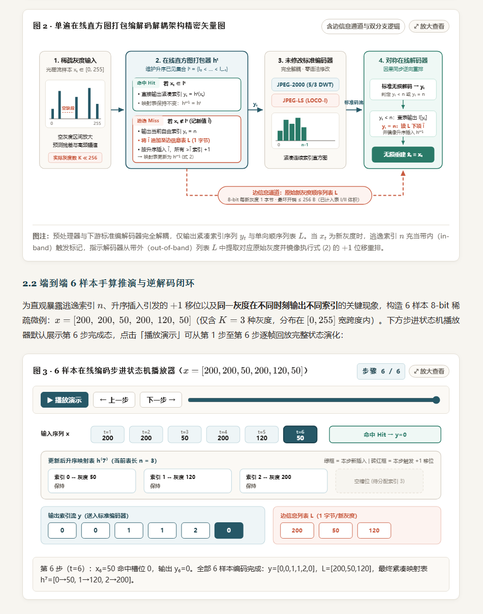
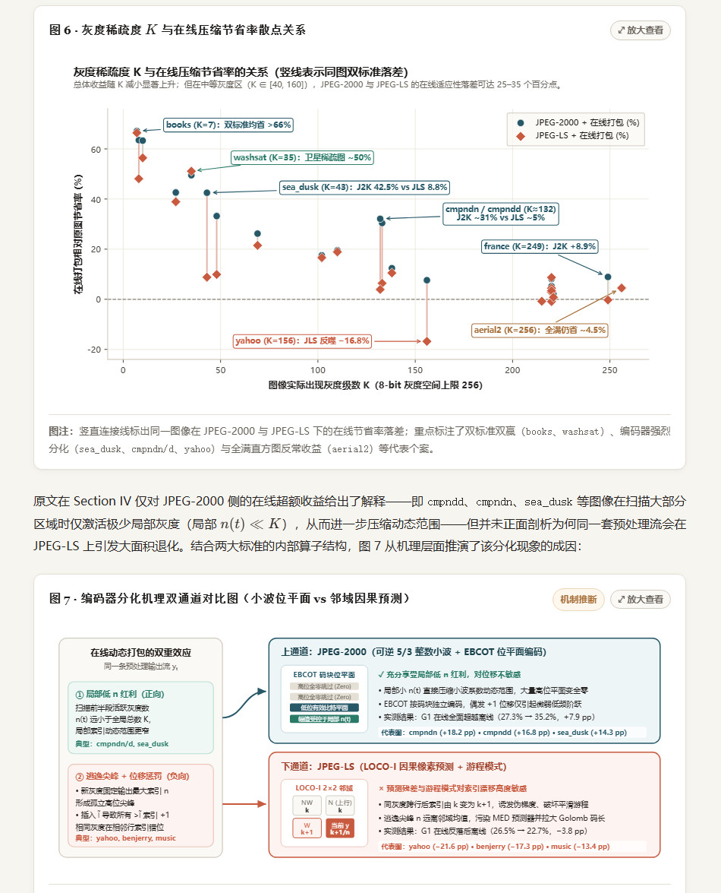
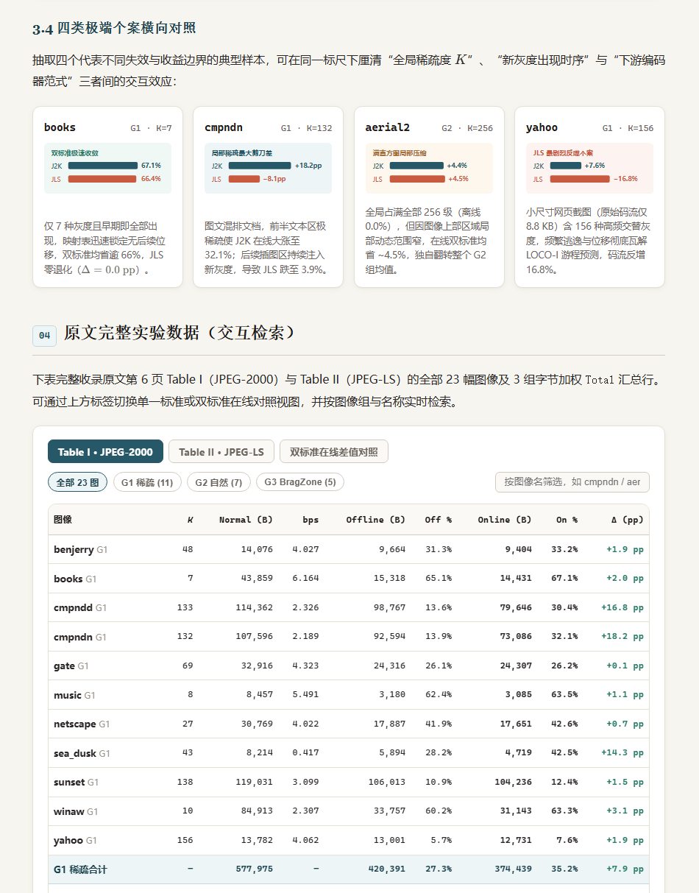

# paper-deep-reader

**English** | [简体中文](README.zh-CN.md)

[](LICENSE)
[](#quick-start)
[](#live-preview--visual-showcase)

> **Transform any research paper PDF (local file, arXiv ID, Open-Access DOI, or Zotero item) into a standalone, self-contained interactive HTML deep-reading monograph** — featuring Warm Paper Morandi editorial typography, page-by-page visually verified equations & tables, precision vector mechanism diagrams, publication-grade Matplotlib SVG plots, interactive data explorers, and a 120fps vector pan/zoom lightbox.

---

## Live Preview & Visual Showcase

- **Online Interactive Demo (GitHub Pages)**: [**View Pinho (2002) Deep-Reading Monograph**](https://yangyannick.github.io/paper-deep-reader/examples/pinho-2002-demo.html)
- **Local Offline File**: Open [`examples/pinho-2002-demo.html`](examples/pinho-2002-demo.html) directly in any browser (no server or build step needed).

Both showcase a complete standalone output built from Pinho (2002), *IEEE Signal Processing Letters*, Vol. 9, No. 1, pp. 5–7.

| Editorial Monograph & Sticky TOC | Precision Vector Architecture & Interactive Stepper |
| :---: | :---: |
|  |  |
| **Full-Width Matplotlib Vector Charts** | **Interactive Data Explorer & Evidence Boundary Audit** |
|  |  |

---

## Why `paper-deep-reader`?

Most AI paper-reading tools force an uncomfortable trade-off:
- **Plain Markdown summaries** lose mathematical visual intuition, interactive exploration, and chart clarity.
- **Generic HTML / diagram skills** often shrink prose into terse slide captions, ship cold English-centric CSS that breaks on CJK academic reading, leak noisy meta-QA stamps into the UI, or stall browsers with render-blocking fonts and heavy blur filters.

`paper-deep-reader` combines four disciplines into one portable Agent Skill:
1. **Visual Grounding Before Writing**: Renders key PDF pages to PNGs via PyMuPDF and visually inspects formulas, multi-column tables, and footnotes before drafting—eliminating OCR hallucinations.
2. **Editorial Warm Paper Morandi Layout**: `#F7F5F0` warm paper ground, `#FFFFFF` cards, muted Teal / Sage / Terracotta / Ochre accents, sticky TOC sidebar, flush 4-KPI hero strip, KaTeX math, zero render-blocking Google Fonts, and zero `backdrop-filter` scroll jank.
3. **Silent Deep-Audit Rigor**: Enforces concrete worked numerical micro-examples, component role hierarchy analysis, and evidence-boundary checks (downplayed regressions, weighted-average skews, unmeasured costs) written as restrained academic prose rather than cluttered QA badges.
4. **Adaptive Vector Visuals & 120fps Lightbox**: Selects visual widgets by paper archetype (algorithm steppers, architecture pipelines, small multiples, error-budget plots), splits dense 15+ sample charts into full-width vector SVGs, and equips every figure with a cursor-anchored wheel-zoom (`50%–500%`) + drag-pan vector lightbox.
5. **Single-File Portable Delivery**: Bundles all CSS, JS, and vector SVGs into one ~200–300 KB `.html` file that opens instantaneously offline on desktop or mobile.

---

## Supported Paper Inputs (Zero Hard Dependencies)

| Input Source | Extra Plugin Needed? | How It Works |
| :--- | :---: | :--- |
| **Local PDF** (`path/to/paper.pdf`) | None | Default path. Reads and renders PDF pages directly via `scripts/extract_pdf.py`. |
| **arXiv ID / URL** (`1706.03762`, `arxiv.org/abs/...`) | None | Built-in `scripts/fetch_paper.py` (Python stdlib only) pulls Atom metadata and downloads the PDF. |
| **Open-Access DOI** (`10.1038/...`) | None | `scripts/fetch_paper.py` queries Crossref metadata + legal OA sources (OpenAlex, Europe PMC, Semantic Scholar, optional Unpaywall). |
| **Paywalled DOI** (`10.1109/...`) | None | Saves verified bibliographic metadata (`exit 2`) and asks you for a local PDF or Zotero entry—never hallucinates from abstracts or uses unauthorized sources. |
| **Zotero 7 Local Library** | None | `scripts/fetch_paper.py --zotero-query` / `--zotero-key` talks directly to Zotero 7's local API (`127.0.0.1:23119`) and resolves local PDF attachments & notes. |
| **`zotero-cli` / `zotero-mcp`** | Optional | Automatically used if already installed in your environment. |

---

## Quick Start

### 1. Install the Skill

Works with **Claude Code**, **Codex**, **Cursor**, **Antigravity**, and any Agent Skills–compatible assistant:

```bash
# Option A: Install via skills CLI
npx skills add yangyannick/paper-deep-reader

# Option B: Clone directly into your local skills directory
git clone https://github.com/yangyannick/paper-deep-reader.git ~/.agents/skills/paper-deep-reader
```

> **Note on explicit invocation**: `paper-deep-reader` is configured for explicit invocation so it never hijacks quick paper questions or casual chat. Trigger it by naming `paper-deep-reader` / `$paper-deep-reader` or asking for an interactive HTML deep-reading page.

### 2. Install Lightweight Python Dependencies

```bash
pip install -r requirements.txt
```

- **Core** (`requirements.txt`): `pymupdf`, `matplotlib`, `numpy`, `pillow` (used for Stage 1 PDF page rendering and Stage 3 publication-grade vector plots). `scripts/fetch_paper.py` uses Python's standard library only.
- **Optional QA tools**: Node.js (`node --check` for JS syntax verification) and any local Chrome / Chromium / Edge browser (auto-detected across Windows, macOS, and Linux for headless 1440px visual QA).

---

## Usage Examples

### A. By Input Source

**1. Local PDF (most reliable, works offline)**
```text
Use $paper-deep-reader to create an interactive HTML deep-reading page for: ./papers/pinho-2002.pdf
```

**2. arXiv ID or URL (auto-downloads metadata & PDF)**
```text
Use $paper-deep-reader on arXiv:1706.03762 ("Attention Is All You Need") and output a standalone HTML monograph.
```

**3. Open-Access DOI (auto-downloads OA PDF via OpenAlex / Semantic Scholar / Unpaywall)**
```text
Use $paper-deep-reader to analyze DOI 10.1038/s41586-021-03819-2.
```

**4. Zotero Library (via Zotero 7 local API or `zotero-cli`)**
```text
Use $paper-deep-reader to read the paper "Online Preprocessing for Sparse Histograms" from my Zotero library, and incorporate my existing Zotero notes into the final engineering insights section.
```

### B. By Paper Archetype

**5. Discrete Algorithm / Compression / State-Machine Paper**
```text
Use $paper-deep-reader on ./papers/pinho-2002.pdf. Include a concrete numerical worked example, an interactive step-by-step algorithm player, a custom input sandbox, and a sortable benchmark table.
```

**6. Deep Learning / Model Architecture / Systems Paper**
```text
Use $paper-deep-reader on arXiv:2312.00752 (Mamba). Focus on the hierarchical architecture diagram with linked highlighting, tensor-shape trace, ablation small multiples, and throughput-vs-context scaling plots.
```

**7. Physics / Signal Processing / Experimental Measurement Paper**
```text
Use $paper-deep-reader on ./papers/interferometer-phase.pdf. Emphasize the physical measurement chain SVG, regime-validity boundaries, calibration assumptions, and error-budget breakdown.
```

### C. By Reading Goal & Output Language

**8. Domain-Transfer & Engineering Boundary Analysis**
```text
Use $paper-deep-reader on ./papers/bitshuffle-2015.pdf. In the final section, evaluate how this method transfers to 16-bit high-rate scientific DAQ streams on FPGA/CPU, explicitly calling out failure modes and memory overhead.
```

**9. Output Language Selection (English / Simplified Chinese / Bilingual Terms)**
```text
Use $paper-deep-reader on arXiv:2405.04434 and write the full interactive HTML monograph in English.
```
```text
使用 $paper-deep-reader 深度精读 ./papers/paper.pdf，正文使用中文学术风格，保留准确的英文专业术语，并将输出保存到 ./exports/paper-reading.html。
```

### D. Standalone Utility Scripts (CLI)

You can also invoke the bundled scripts directly outside an agent session:

```bash
# 1. Fetch PDF & metadata from arXiv / OA DOI / Zotero 7 local API
python scripts/fetch_paper.py --source 1706.03762 --out ./temp/demo
python scripts/fetch_paper.py --source 10.1038/s41586-021-03819-2 --out ./temp/demo
python scripts/fetch_paper.py --zotero-query "sparse histograms" --out ./temp/demo

# 2. Extract text & render verification PNGs (200 DPI)
python scripts/extract_pdf.py --pdf ./temp/demo/arxiv_1706.03762.pdf --out ./temp/demo --pages 1-6 --dpi 200

# 3. Run static QA on a generated HTML file (KaTeX, SVG IDs, JS syntax, anti-patterns)
python scripts/qa_static.py examples/pinho-2002-demo.html --strict-cliches

# 4. Capture 1440px headless browser QA slices (Chrome / Chromium / Edge)
python scripts/qa_browser_shots.py --html examples/pinho-2002-demo.html --out ./temp/demo/qa_shots
```

---

## 4-Stage Workflow & Repository Layout

```text
paper-deep-reader/
├── SKILL.md                           # 4-stage workflow, input adapters & paper-type adaptation rules
├── agents/
│   └── openai.yaml                    # Explicit-invocation policy for Codex
├── assets/
│   ├── theme-morandi.css              # Warm Paper Morandi editorial stylesheet & lightbox CSS
│   ├── widgets.js                     # rAF TOC spy, data-ref linking, 120fps vector pan/zoom lightbox
│   └── morandi-academic.mplstyle      # Harmonized Matplotlib academic style
├── references/
│   ├── academic-writing-guide.md      # Narrative order, worked examples & silent evidence-audit rules
│   ├── diagram-and-layout-guide.md    # Vector diagram craft & adaptive interactive widgets
│   └── plotting-guide.md              # Full-width vs dual-panel rules & visual QA checklist
├── scripts/
│   ├── fetch_paper.py                 # Stdlib-only fetcher for arXiv, OA DOI, PDF URL & Zotero 7 local API
│   ├── extract_pdf.py                 # PyMuPDF text extraction + verification page PNG renderer
│   ├── assemble_html.py               # Single-file HTML bundler + SVG metadata stripper & ID prefixer
│   ├── qa_static.py                   # Static QA (KaTeX, duplicate IDs, anti-patterns, node --check)
│   └── qa_browser_shots.py            # Cross-platform headless Chrome/Edge visual QA slicer
├── docs/images/                       # README visual showcase screenshots
├── examples/
│   └── pinho-2002-demo.html           # Complete standalone HTML demo
├── requirements.txt
├── README.md                          # English documentation
├── README.zh-CN.md                    # Simplified Chinese documentation
└── LICENSE                            # MIT
```

1. **Stage 1 · Source Grounding**: Fetch or load the PDF, render key pages to PNGs via PyMuPDF, visually inspect equations/tables/footnotes, and cross-check summary totals in Python.
2. **Stage 2 · Monograph Synthesis & Silent Deep-Audit**: Draft clean academic prose with concrete worked examples, component role hierarchy, and evidence boundaries—without backstage QA badge noise.
3. **Stage 3 · Adaptive Visuals & Assembly**: Craft precision inline SVGs, generate and visually inspect Matplotlib vector plots (`morandi-academic.mplstyle`), add paper-appropriate interactive widgets, and assemble one standalone HTML file.
4. **Stage 4 · Dual-Layer QA**: Run `qa_static.py` + `qa_browser_shots.py`, inspect rendered 1440px screenshots, fix any clipping or spacing flaws, and deliver the standalone `.html`.

---

## FAQ & Troubleshooting

- **Why did a DOI return `PAYWALL_OR_NO_OA_PDF`?**  
  Publisher DOIs (e.g., IEEE, Elsevier, Springer non-OA papers) do not expose legal open-access PDFs via Crossref/OpenAlex/Semantic Scholar. `fetch_paper.py` intentionally refuses unauthorized mirror sources, saves verified metadata, and asks you to pass a local PDF or Zotero item. Setting `UNPAYWALL_EMAIL=you@example.com` also enables Unpaywall lookups for repository/author-accepted manuscripts.
- **How do I enable Zotero 7 Local API (zero-plugin Zotero reading)?**  
  Open Zotero 7 → **Settings → Advanced → General** → check *"Allow other applications on this computer to communicate with Zotero"*. If your Zotero data folder is not in `~/Zotero`, pass `--zotero-dir /path/to/Zotero`.
- **Does the output HTML require an internet connection?**  
  All CSS, JavaScript, data, and vector SVG diagrams are embedded directly inside the single `.html` file. Only the KaTeX CDN script is loaded externally for LaTeX formula typesetting (with graceful fallback); zero Google Fonts or external image hosts are used.
- **Why does `qa_browser_shots.py` say `QA_BROWSER_SKIPPED`?**  
  Visual screenshot slicing requires Chrome, Chromium, or Microsoft Edge installed locally. If none is detected, static QA (`qa_static.py`) still runs completely offline.

---

## Credits & License

All templates, stylesheets, scripts, and guides in this repository are written from scratch under the [MIT License](LICENSE). The workflow design draws inspiration from several open-source ideas in the AI research and agent-skills ecosystem:
- Vector mechanism diagrams, linked highlighting, steppers, and small multiples inspired by [`visual-explainer`](https://github.com/nicobailon/visual-explainer) (MIT).
- Deep close-reading rigor (worked micro-examples, component load-bearing hierarchy, and evidence-boundary audits) inspired by academic paper X-ray reading workflows.
- Publication-grade Matplotlib render-inspect-revise loops inspired by academic plotting workflows.
- Optional Zotero local library workflow compatible with Zotero 7 Local API and [`zotero-mcp`](https://github.com/54yyyu/zotero-mcp) (MIT).
