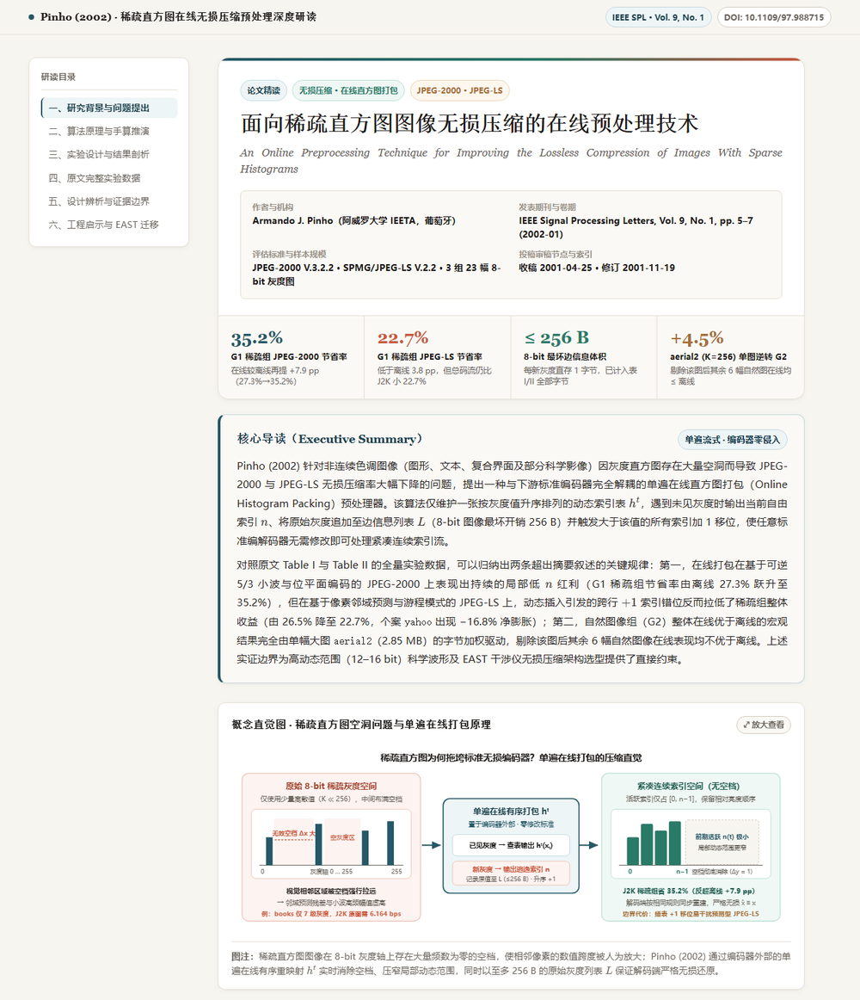
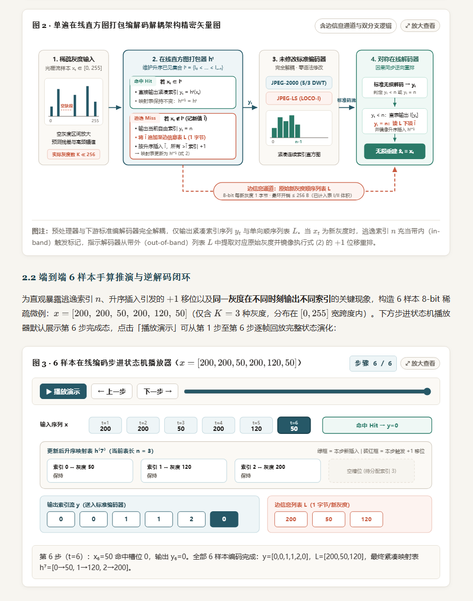
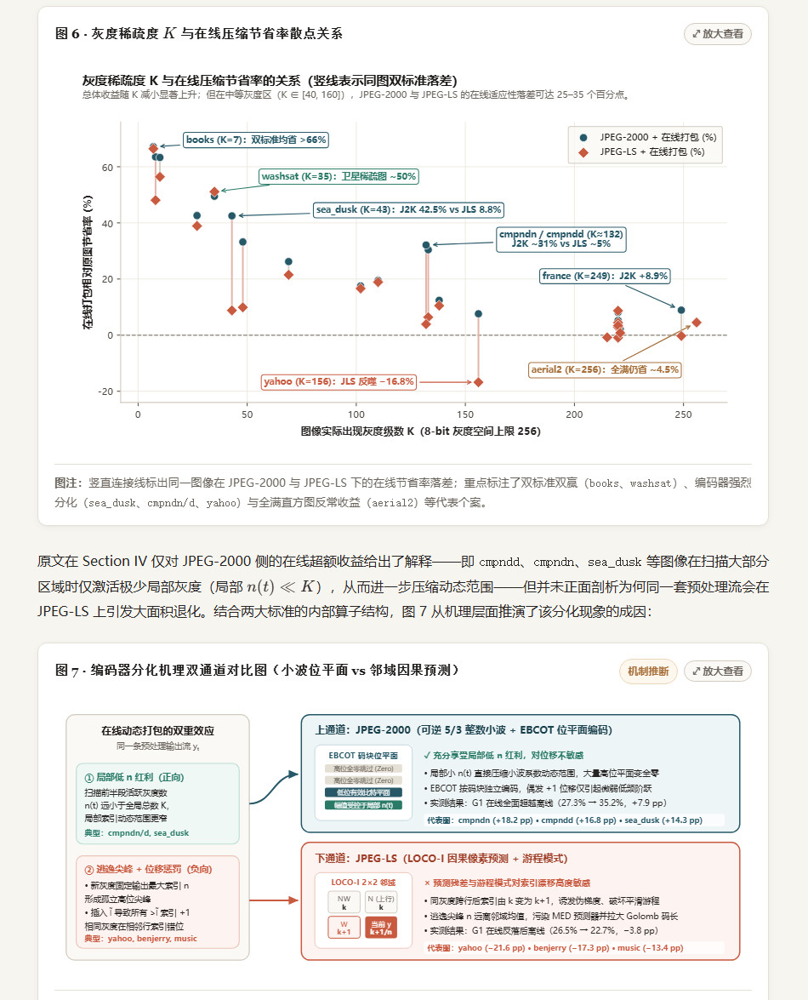
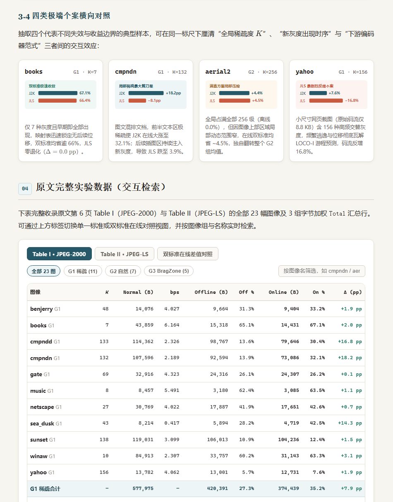

# paper-deep-reader

[English](README.md) | **简体中文**

[](LICENSE)
[](#快速开始)
[](#效果预览)

> **将任意学术论文 PDF（本地文件、arXiv ID、开放获取 DOI 或 Zotero 文献）转化为单文件、零依赖、可离线分享的交互式深度精读 HTML 长文**——融合暖纸莫兰迪学术刊物排版、逐页视觉核验的公式与表格、精密矢量机制图、出版级 Matplotlib 矢量统计图、交互式原始数据表与 120fps 矢量缩放灯箱。

---

## 效果预览

- **在线交互式预览（GitHub Pages）**：[**点击体验 Pinho (2002) 完整精读页面**](https://yangyannick.github.io/paper-deep-reader/examples/pinho-2002-demo.html)
- **本地离线查看**：直接在浏览器中打开 [`examples/pinho-2002-demo.html`](examples/pinho-2002-demo.html)（无需本地服务器或构建步骤）。

示例基于 Pinho (2002), *IEEE Signal Processing Letters*, Vol. 9, No. 1, pp. 5–7 生成。

| 暖纸莫兰迪刊物排版与左侧悬浮目录 | 精密矢量机制图与交互式步进演示 |
| :---: | :---: |
|  |  |
| **全宽出版级 Matplotlib 矢量统计图** | **交互式原始数据表与证据边界剖析** |
|  |  |

---

## 为什么做 `paper-deep-reader`？

现有的 AI 读论文工具通常存在明显短板：
- **纯 Markdown 摘要**：丢失视觉机制直觉、图表联动与交互式探索能力，长文阅读体验枯燥。
- **通用 HTML / 画图 Skill**：往往把学术论述压缩成零碎的幻灯片图注、采用破坏中文学术阅读节奏的英文 CSS、在页面里塞满刺眼的“校验通过”后台标记，或者因为外链字体和毛玻璃特效导致打开与滚动卡顿。

`paper-deep-reader` 将四个关键能力收束进一个开箱即用的 Agent Skill：
1. **逐页视觉核验再动笔**：用 PyMuPDF 将关键页渲染为高分辨率 PNG 并逐页人工/视觉核对公式、多栏表格与脚注，杜绝文本抽取错位和编造数字。
2. **暖纸莫兰迪学术长文排版**：`#F7F5F0` 暖纸底色 + `#FFFFFF` 纯白卡片 + 灰青/鼠尾草绿/陶土红/暖赭低饱和配色，左侧悬浮目录、四指标 KPI 条、KaTeX 公式排版；移除阻塞渲染的 Google Fonts 与拖垮帧率的 `backdrop-filter`，页面秒开顺滑。
3. **静默深度剖析，不污染读者界面**：强制输出完整小规模手算微算例、组件承重分层与证据边界审计（隐藏退化项、加权平均掩盖、未测算开销），用克制流畅的学术散文自然呈现，绝不堆砌 `[原文核验事实]`、`校验通过` 等后台脚手架噪音。
4. **按论文类型自适应的矢量交互组件 + 120fps 缩放灯箱**：根据论文类型动态选用步进播放器、自定义沙盒、层级架构高亮联动或小多图矩阵；数据密集的统计图自动拆分为全宽矢量 SVG；全页所有图表支持**以鼠标为锚点的滚轮缩放（50%–500%）+ 鼠标拖拽平移**。
5. **单文件便携交付**：CSS、JS 与全部矢量 SVG 内联打包为约 200–300 KB 的单个 `.html` 文件，桌面与移动端离线即开即看。

---

## 支持的论文输入源（零硬依赖）

| 输入方式 | 是否需要额外插件 | 工作方式说明 |
| :--- | :---: | :--- |
| **本地 PDF**（`path/to/paper.pdf`） | 不需要 | 默认入口，直接调用 `scripts/extract_pdf.py` 提取文本并渲染核验页图。 |
| **arXiv ID / 链接**（`1706.03762` 等） | 不需要 | 内置纯标准库脚本 `scripts/fetch_paper.py`，自动拉取 Atom 元数据并下载 PDF。 |
| **开放获取 DOI**（`10.1038/...`） | 不需要 | `scripts/fetch_paper.py` 查 Crossref 元数据，并依次从 OpenAlex、Europe PMC、Semantic Scholar、可选 Unpaywall 下载合法 OA PDF。 |
| **付费墙 DOI**（`10.1109/...`） | 不需要 | 仅保存可信书目元数据并退出（退出码 `2`），明确提示提供本地 PDF 或 Zotero 条目——绝不凭摘要硬编，也不调用灰色源。 |
| **Zotero 7 本地文献库** | 不需要 | `scripts/fetch_paper.py --zotero-query` / `--zotero-key` 直连 Zotero 7 本地 API（`127.0.0.1:23119`），自动读取元数据、笔记并定位本地 PDF 附件。 |
| **`zotero-cli` / `zotero-mcp`** | 可选 | 如果你的本机已安装，Agent 会自动无缝复用，无需重复配置。 |

---

## 快速开始

### 1. 安装 Skill

兼容 **Claude Code**、**Codex**、**Cursor**、**Antigravity** 及所有支持 Agent Skills 规范的 AI 助手：

```bash
# 方式一：通过 skills CLI 安装
npx skills add yangyannick/paper-deep-reader

# 方式二：直接克隆到本地 skills 目录
git clone https://github.com/yangyannick/paper-deep-reader.git ~/.agents/skills/paper-deep-reader
```

> **关于显式调用**：`paper-deep-reader` 默认配置为显式触发，不会在你随口问一句论文问题时误启动。需要使用时在提示词中点名 `paper-deep-reader` / `$paper-deep-reader`，或明确要求生成交互式深度精读 HTML 页面即可。

### 2. 安装轻量 Python 依赖

```bash
pip install -r requirements.txt
```

- **核心依赖**（`requirements.txt`）：`pymupdf`、`matplotlib`、`numpy`、`pillow`（用于 PDF 渲染与出版级矢量统计图）。其中 `scripts/fetch_paper.py` 仅使用 Python 标准库，零额外依赖。
- **可选质检工具**：Node.js（用于 `node --check` 校验内联 JS 语法）以及任意本机 Chrome / Chromium / Edge 浏览器（自动跨平台探测，用于 1440px 无头渲染截图质检）。

---

## 使用案例大全

### 一、按输入源分类

**1. 本地 PDF（最稳定，支持纯离线）**
```text
使用 $paper-deep-reader 深度精读这篇论文：D:\papers\pinho-2002.pdf
```

**2. arXiv ID 或链接（自动下载 PDF 与元数据）**
```text
使用 $paper-deep-reader 精读 arXiv:1706.03762（Attention Is All You Need），生成单文件交互式 HTML 精读页面。
```

**3. 开放获取 DOI（自动走 Crossref + OpenAlex / Semantic Scholar 下载 OA PDF）**
```text
使用 $paper-deep-reader 精读这篇 DOI 论文：10.1038/s41586-021-03819-2
```

**4. Zotero 本地文献库（支持 Zotero 7 本地 API 或 `zotero-cli`）**
```text
使用 $paper-deep-reader 读取我 Zotero 里的论文《Online Preprocessing for Sparse Histograms》，并把我已有的 Zotero 阅读笔记融合进最后的工程迁移分析里。
```

### 二、按论文类型分类

**5. 离散算法 / 编解码 / 状态机类论文**
```text
使用 $paper-deep-reader 深度精读 ./papers/pinho-2002.pdf。重点讲透状态转移公式，给出完整小规模手算闭环算例、交互式步进演示器、自定义输入沙盒以及可排序的原始实验数据表。
```

**6. 深度学习 / 模型架构 / 系统类论文**
```text
使用 $paper-deep-reader 精读 arXiv:2312.00752（Mamba）。重点绘制带高亮联动的层级架构图、张量维度推演过程、消融对比 Small Multiples 以及吞吐-序列长度扩展曲线。
```

**7. 物理 / 信号处理 / 实验测量类论文**
```text
使用 $paper-deep-reader 精读 ./papers/interferometer-phase.pdf。重点画出测量链路物理机制图，梳理标定假设、不同工作区间的适用边界以及误差预算分解。
```

### 三、按研究目标与输出语言分类

**8. 结合自身研究方向的工程迁移与失效边界分析**
```text
使用 $paper-deep-reader 精读 ./papers/bitshuffle-2015.pdf，并在最后结合我的研究方向（高位深 16-bit 高速科学采集数据流的 FPGA/CPU 实时无损压缩）分析可迁移组件、硬件开销和失效边界。
```

**9. 指定输出语言（全英文 / 中文学术风 + 英文原术语）**
```text
Use $paper-deep-reader on arXiv:2405.04434 and output the entire interactive HTML monograph in English.
```
```text
使用 $paper-deep-reader 精读 ./papers/paper.pdf，正文采用克制的中文学术风格，保留关键英文专业术语，输出到 ./exports/paper-deep-read.html。
```

### 四、独立命令行工具用法

仓库内的工具脚本也可以在终端直接单独运行：

```bash
# 1. 从 arXiv / 开放获取 DOI / Zotero 7 本地 API 拉取 PDF 与元数据
python scripts/fetch_paper.py --source 1706.03762 --out ./temp/demo
python scripts/fetch_paper.py --source 10.1038/s41586-021-03819-2 --out ./temp/demo
python scripts/fetch_paper.py --zotero-query "sparse histograms" --out ./temp/demo

# 2. 提取全文并渲染 200 DPI 核验页图
python scripts/extract_pdf.py --pdf ./temp/demo/arxiv_1706.03762.pdf --out ./temp/demo --pages 1-6 --dpi 200

# 3. 对生成的 HTML 运行静态质检（KaTeX、重复 SVG ID、JS 语法、禁用套话）
python scripts/qa_static.py examples/pinho-2002-demo.html --strict-cliches

# 4. 捕获 1440px 无头浏览器渲染切片（自动探测 Chrome / Chromium / Edge）
python scripts/qa_browser_shots.py --html examples/pinho-2002-demo.html --out ./temp/demo/qa_shots
```

---

## 四阶段工作流与仓库结构

```text
paper-deep-reader/
├── SKILL.md                           # 四阶段主流程、输入源适配与论文类型自适应规范
├── agents/
│   └── openai.yaml                    # Codex 显式调用策略配置
├── assets/
│   ├── theme-morandi.css              # 暖纸莫兰迪学术排版样式表与灯箱样式
│   ├── widgets.js                     # rAF 目录联动、data-ref 高亮、120fps 矢量缩放灯箱
│   └── morandi-academic.mplstyle      # 配色统一的 Matplotlib 学术图表样式
├── references/
│   ├── academic-writing-guide.md      # 学术叙事顺序、手算算例与静默证据审计规范
│   ├── diagram-and-layout-guide.md    # 矢量机制图工艺与交互组件选型指南
│   └── plotting-guide.md              # 全宽 vs 双栏统计图拆图规则与视觉自检清单
├── scripts/
│   ├── fetch_paper.py                 # 零依赖论文拉取器（arXiv / OA DOI / PDF URL / Zotero 7）
│   ├── extract_pdf.py                 # PyMuPDF 文本提取 + 逐页 PNG 视觉核验渲染器
│   ├── assemble_html.py               # 单文件 HTML 组装器（清理 SVG 元数据并隔离 ID）
│   ├── qa_static.py                   # 静态质检脚本（公式、ID、套话、JS 语法检查）
│   └── qa_browser_shots.py            # 跨平台无头浏览器 1440px 视觉质检切片脚本
├── docs/images/                       # README 效果展示截图
├── examples/
│   └── pinho-2002-demo.html           # 完整单文件 HTML 示例
├── requirements.txt
├── README.md                          # 英文文档
├── README.zh-CN.md                    # 简体中文文档
└── LICENSE                            # MIT 开源协议
```

1. **阶段一 · 源文献落地与视觉保真核验**：加载或下载 PDF，将关键页渲染为 PNG 并逐页核对公式、表格与脚注，必要时用 Python 复核汇总统计一致性。
2. **阶段二 · 学术长文综合与静默深度审计**：按经典学术阅读顺序撰写正文，落实完整数值微算例、组件承重分层与证据边界核查，不向读者 UI 泄露后台质检标签。
3. **阶段三 · 自适应视觉分层与单文件组装**：绘制真实机制的中文/目标语言矢量 SVG，使用 `morandi-academic.mplstyle` 绘制并逐图目视复检统计图，再通过 `assemble_html.py` 打包为单文件 HTML。
4. **阶段四 · 双层质检与交付**：依次通过 `qa_static.py` 静态校验和 `qa_browser_shots.py` 1440px 浏览器切片视觉审查，修复任何裁切或重叠后交付最终 `.html`。

---

## 常见问题（FAQ & Troubleshooting）

- **为什么给某些 DOI 会提示 `PAYWALL_OR_NO_OA_PDF`？**  
  IEEE、Elsevier、Springer 等非开放获取期刊受出版商版权保护，Crossref / OpenAlex / Semantic Scholar 只提供书目元数据而不提供全文 PDF。`fetch_paper.py` 遵循合规原则，不接入灰色下载源，也不允许模型仅凭摘要脑补公式和表格；此时直接提供本地 PDF 或从 Zotero 读取即可。设置环境变量 `UNPAYWALL_EMAIL=you@example.com` 可额外启用 Unpaywall 合法机构库/预印本检索。
- **零插件模式下如何开启 Zotero 7 本地 API？**  
  打开 Zotero 7 → **设置 → 高级 → 常规** → 勾选「允许此计算机上的其他应用程序与 Zotero 通信」。如果你的 Zotero 数据目录不在默认的 `~/Zotero`，运行脚本时加上 `--zotero-dir <你的Zotero目录>`。
- **生成的 HTML 必须联网才能看吗？**  
  页面样式、脚本、数据表与所有矢量图表全部内联在单个 `.html` 文件中，不依赖 Google Fonts 或外链图床；仅数学公式排版按需加载 KaTeX CDN（离线时正文、表格与所有矢量图仍可正常浏览）。
- **`qa_browser_shots.py` 提示 `QA_BROWSER_SKIPPED` 怎么办？**  
  视觉切片质检需要本机装有 Chrome、Chromium 或 Microsoft Edge。若环境里没有浏览器，静态质检（`qa_static.py`）仍可完整运行，不受影响。

---

## 致谢与开源协议

本仓库全部模板、样式表、脚本与方法指南均基于 [MIT License](LICENSE) 从零原创编写。工作流设计借鉴了开源社区在科研与 Agent Skills 领域的若干优秀理念：
- 精密矢量机制图、高亮联动、步进演示器与小多图矩阵的交互理念受 [`visual-explainer`](https://github.com/nicobailon/visual-explainer)（MIT）启发；
- 手算微算例、组件承重判断与证据边界审查受学术论文深度 X-ray 精读工作流启发；
- 统计图“渲染—目视自检—修正”闭环受学术绘图工作流启发；
- 可选的 Zotero 本地文献库联动兼容 Zotero 7 Local API 与 [`zotero-mcp`](https://github.com/54yyyu/zotero-mcp)（MIT）。
